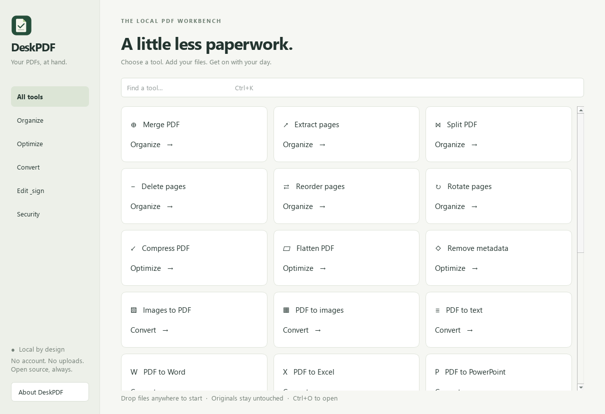
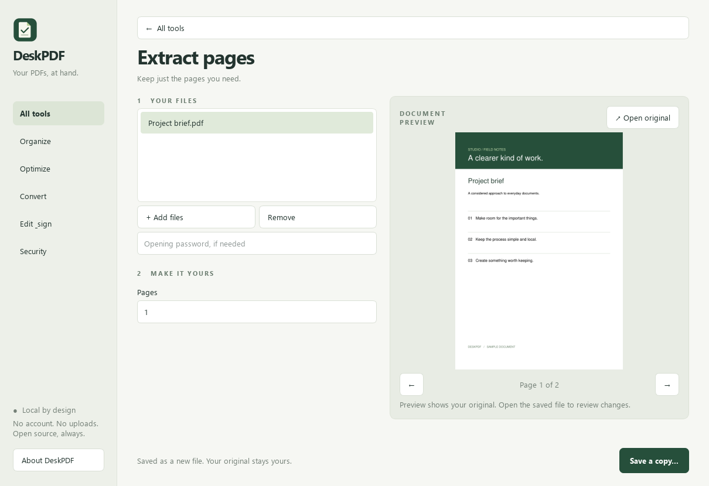

# DeskPDF

**Your PDFs, at hand.** A quiet, local-first PDF workbench for Windows.



DeskPDF brings common PDF jobs into one native desktop app: choose a tool, add a file, save a copy. Documents are processed on your computer. No account, telemetry, server, or upload service.

## Install

Download the installer from [GitHub Releases](https://github.com/pommfritzer/DeskPDFtoolkit/releases), or run `DeskPDF-0.1.0-Setup.exe` from the local `releases` folder. The installer includes Python, Qt and the PDF engine; users do not install Python. Installation is per user and needs no administrator privileges.

The optional Explorer integration adds **Open in DeskPDF**, **Compress with DeskPDF**, and **Extract pages with DeskPDF** to PDF right-click menus. On Windows 11, use **Show more options**. Your default PDF reader is unchanged. Uninstall from Windows Settings to remove the app and its menu entries.

Target: Windows 10/11, x64. The initial build is unsigned; Windows may show an unknown-publisher notice. Signing is a release-maintainer task.

## Tools

| Area | Available tools |
| --- | --- |
| Organize | Merge, extract, split, delete, reorder, rotate |
| Optimize | Lossless compression, flatten forms/annotations, remove metadata and embedded attachments |
| Convert | Images → PDF, PDF → PNG, text, Word, Excel, PowerPoint; Office → PDF; OCR |
| Edit & sign | Add text, watermark, page numbers, crop, redact text, highlight text, place a signature image, fill existing forms |
| Security | AES-256 password protection; password-authorized unlocking |

Page selections accept `all`, `1,3-5`, descending ranges such as `5-1`, and duplicates for extraction/reordering. Drag input files to set merge order. Click a document preview to position text or a signature. Coordinates and dimensions use PDF points (72 points per inch).



### Honest boundaries

- Compression is lossless structural optimization. Already optimized files may stay the same size or grow slightly.
- Word export produces editable text and page breaks, without reconstructing the original layout. Scans need OCR first.
- Excel export detects tables, rather than inferring an entire spreadsheet. Exported strings remain strings, including text beginning with `=`.
- PowerPoint export produces one page image per slide; slide contents are not individually editable.
- Office input requires a separate local [LibreOffice](https://www.libreoffice.org/) installation. Supported formats depend on that installation.
- OCR requires [Tesseract](https://tesseract-ocr.github.io/tessdoc/Installation.html) and its requested language data. It rasterizes pages and replaces them with searchable page images; existing forms, links and annotations are not retained.
- Text overlays add content; this is not an editor for rewriting existing PDF paragraphs. Standard-font overlays support Latin text. Use a signature image for other scripts.
- Signatures are placed images, not cryptographic certificate signatures or a remote signing service.
- Redaction removes exact searchable text matches and overlapping image content. It does not detect sensitive information, redact scans by appearance, or sanitize every hidden data source. Inspect the saved file. Metadata removal clears standard/XML metadata and embedded files; it is not a complete forensic sanitizer.
- Cropping hides margins rather than deleting the content outside them.
- Form filling supports existing AcroForm widgets, not XFA forms. Checkbox values must match their export values.
- Editing preserves source encryption unless you explicitly choose Unlock. Modifications can invalidate existing digital signatures.
- Cloud collaboration, remote signature requests, AI chat/translation, PDF/A certification, scanner hardware acquisition, and editing arbitrary original text are outside this initial release.
- Preview displays the original document. Open the saved result to inspect your changes.

## Develop

```powershell
py -3.13 -m venv .venv
.\.venv\Scripts\python -m pip install -e ".[dev]"
.\.venv\Scripts\python run.py
.\.venv\Scripts\python -m pytest -q
```

Python 3.11+ is supported; the release workflow uses 3.13. `requirements-lock.txt` records the exact packages used for the initial Windows build (Python 3.14). To recreate that build environment, install that file before installing the project with `--no-deps`.

```powershell
.\.venv\Scripts\python run.py --tool extract "C:\Documents\example.pdf"
```

## Build an installer

Install [Inno Setup 6](https://jrsoftware.org/isinfo.php), then:

```powershell
.\scripts\build.ps1
```

The script regenerates the icon, runs tests, collects dependency licenses, bundles a standalone application with PyInstaller, checks bundled startup, and compiles `releases/DeskPDF-0.1.0-Setup.exe`. Dependency discovery uses an isolated PATH to avoid picking up incompatible DLLs from unrelated installed software. The portable app is in `dist/DeskPDF`. The Windows GitHub Actions workflow builds and uploads the installer on pushes and pull requests. Publishing a release is separate.

## Architecture

- `deskpdf/catalog.py`: declarative tool definitions and UI options.
- `deskpdf/engine.py`: PDF operations, validation and atomic output saving; no GUI dependencies.
- `deskpdf/app.py`: Qt widgets, file selection, preview and background jobs.
- `deskpdf/theme.py`: centralized visual styling.
- `installer/DeskPDF.iss`: per-user installer and removable Explorer commands.
- `tests/`: generated documents verify content, page order, redaction, encryption, form values, exports, and failure behavior.

The app uses Python and PySide6 for legible, direct native UI code; MuPDF handles PDF rendering and manipulation. Work runs on a background thread while controls are locked against competing edits. Files are staged beside the destination, then atomically replaced only after successful processing. Input paths cannot be output paths.

See [design decisions](docs/DESIGN.md), [contributing](CONTRIBUTING.md), and [third-party notices](THIRD_PARTY_NOTICES.md).

## License

AGPL-3.0-or-later. See [LICENSE](LICENSE). DeskPDF has its own branding and implementation; it is not affiliated with Smallpdf.
